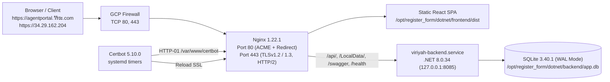

# Server Architecture, Deployment & HTTPS Operations Guide

เอกสารสรุปรายละเอียดโครงสร้างเซิร์ฟเวอร์ การตั้งค่า Google Compute Engine VM, ระบบฐานข้อมูล, ระบบ HTTPS (Let's Encrypt ฟรี) และการ Deploy สำหรับโครงการ **ระบบลงทะเบียนขอรับและขอต่ออายุใบอนุญาตตัวแทนและนายหน้าประกันวินาศภัย (บมจ. วิริยะประกันภัย)**

---

## 1. ภาพรวมสถาปัตยกรรม (Production VM Architecture)



### สภาพแวดล้อมทั้งหมดในโครงการ

| Environment | Frontend / Web URL | Backend / API | Database | หมายเหตุ |
| :--- | :--- | :--- | :--- | :--- |
| **GCE VM (`free-tier-vm`)** | `https://agentportal.วิริยะ.com/`<br/>`https://34.29.162.204/` | Same-Origin `/api` → Nginx Proxy → `127.0.0.1:8085` | SQLite (`app.db`, WAL Mode, 46 ตาราง) | ติดตั้ง Native `.NET 8 + Nginx` + Let's Encrypt HTTPS |
| **Google Cloud Run** | `https://register-frontend-779142529105.us-central1.run.app/login` | `https://register-backend-779142529105.us-central1.run.app/api` | Embedded SQLite (`/App/app.db`) | ใช้คู่กับ GCS Backup `gs://viriyahiptc2/db_backup/` |
| **Local Development** | `http://localhost/` (Apache) | `http://localhost:8085/api` | MS SQL Server (`thaiairp_iptc`) | ซิงค์เข้า `app.db` ผ่าน `export_mssql_to_sqlite.py` |

---

## 2. ข้อมูลโครงสร้างพื้นฐาน GCE VM & Firewall

| รายการ | ค่าที่ใช้งานจริง |
| :--- | :--- |
| **GCP Project** | `project-86010b3e-ea84-4c5a-8ec` (`NeonX`) |
| **VM Instance / Zone** | `free-tier-vm` / `us-central1-a` |
| **Machine Spec** | `e2-micro` (`969 MiB` RAM + Swap `2.0 GiB` ที่ `/swapfile` ใน `/etc/fstab`) |
| **OS & Storage** | Debian 12 (Bookworm), Disk `30 GB` |
| **Internal IP / Subnet** | `10.128.0.2` (`default` network, `us-central1`) |
| **External IP** | `34.29.162.204` (`PREMIUM` Network Tier, แบบ Ephemeral `ONE_TO_ONE_NAT`) |
| **Network Tags** | `http-server`, `https-server` |

> [!IMPORTANT]
> **ข้อควรทราบเรื่อง Ephemeral IP (`34.29.162.204`):** External IP ปัจจุบันเป็นแบบ Ephemeral ตราบใดที่ VM ยังเปิดทำงานอยู่หรือใช้การ Reboot ตามปกติ IP จะไม่เปลี่ยน แต่หาก **Stop แล้ว Start VM ใหม่** จาก GCP Console แล้วได้ IP ใหม่ ต้องอัปเดต `A` Record ใน DNS, ขอใบรับรอง Let's Encrypt ด้วย IP ใหม่ และอัปเดตพาธ SSL ใน Nginx ตามไปด้วย

### กฎ Firewall ใน GCP

| Rule Name | Ports / Protocol | Target Tags | Source Ranges |
| :--- | :--- | :--- | :--- |
| `default-allow-http` | `tcp:80` | `http-server` | `0.0.0.0/0` |
| `default-allow-https` | `tcp:443` | `https-server` | `0.0.0.0/0` |
| `default-allow-ssh` | `tcp:22` | All instances | `0.0.0.0/0` |
| `default-allow-rdp` | `tcp:3389` | All instances | `0.0.0.0/0` |
| `default-allow-icmp` | `icmp` | All instances | `0.0.0.0/0` |
| `default-allow-internal` | `tcp:0-65535`, `udp:0-65535`, `icmp` | All instances | `10.128.0.0/9` |

---

## 3. Domain, DNS และ Endpoint URLs

- **Domain (IDN ภาษาไทย):** `agentportal.วิริยะ.com`
- **Punycode (ACE Name สำหรับ DNS / Nginx / SSL):** `agentportal.xn--z3cbl2brb.com`
- **Authoritative Nameservers (`xn--z3cbl2brb.com`):** `ns-cloud-c1..c4.googledomains.com`
- **สถานะ DNS (`A` Record):** ชี้ตรงมาที่ **`34.29.162.204`** เพียง IP เดียว (`TTL: 14400`, ไม่มี `AAAA`/`CAA`) และออกใบรับรอง SSL เรียบร้อยแล้ว

### URLs บน VM (HTTPS พร้อม HTTP → HTTPS `301` Redirect)
- หน้าเว็บไซต์หลัก: https://agentportal.วิริยะ.com/ (หรือ https://34.29.162.204/)
- หน้าเข้าสู่ระบบ: https://agentportal.วิริยะ.com/login
- Swagger API Docs: https://agentportal.วิริยะ.com/swagger/index.html
- Health Check: https://agentportal.วิริยะ.com/health

---

## 4. Runtime, โครงสร้างไฟล์ และการตั้งค่าฐานข้อมูลบน VM

### ซอฟต์แวร์ที่ติดตั้งบน VM
- **Web Server / Proxy:** `nginx/1.22.1`
- **Backend Runtime:** `Microsoft.AspNetCore.App 8.0.34` / `Microsoft.NETCore.App 8.0.34` (`linux-x64`)
- **Database Engine:** `sqlite3 3.40.1`
- **SSL Client:** `certbot 5.10.0` (ติดตั้งใน Python `3.11.2` venv ที่ `/opt/certbot` พร้อม symlink `/usr/local/bin/certbot`)

### โครงสร้างโฟลเดอร์สำคัญบน VM
- `/opt/register_form/dotnet` *(เจ้าของสิทธิ์ `www-data:www-data`)*
  - `/opt/register_form/dotnet/frontend/dist` — ไฟล์ build ของ React SPA (ให้บริการโดย Nginx)
  - `/opt/register_form/dotnet/backend/out_linux/backend.dll` — ไบนารี .NET 8 Backend (รันแบบ Native Linux x64)
  - `/opt/register_form/dotnet/backend/app.db` — ฐานข้อมูล SQLite คัดลอกจาก SQL Server (`thaiairp_iptc`)
  - `/opt/register_form/dotnet/backend/appsettings.Production.json` — ตั้งค่าเฉพาะบน VM (ไม่เก็บทับใน Git เพื่อไม่ให้กระทบ Cloud Run ซึ่งใช้ `/App/app.db`):
    ```json
    {
      "Logging": {
        "LogLevel": {
          "Default": "Information",
          "Microsoft.AspNetCore": "Warning"
        }
      },
      "AllowedHosts": "*",
      "ConnectionStrings": {
        "DefaultConnection": "Data Source=/opt/register_form/dotnet/backend/app.db"
      }
    }
    ```
  - `/opt/register_form/dotnet/backend/LocalData` — ไฟล์สื่อและไฟล์นำเข้าของ OIC
- `/var/www/certbot` *(เจ้าของสิทธิ์ `www-data:www-data`)* — Webroot สำหรับ Let's Encrypt `HTTP-01` Challenge (`/.well-known/acme-challenge/`)

### การคัดลอกและทำงานกับฐานข้อมูล SQLite
เนื่องจาก VM รุ่น `e2-micro` มี RAM `969 MiB` ซึ่งต่ำกว่าความต้องการขั้นต่ำของ MS SQL Server (2,000 MB) ระบบบน VM จึงใช้ฐานข้อมูล SQLite ที่ซิงค์ตรงจาก SQL Server ผ่าน [`export_mssql_to_sqlite.py`](../../export_mssql_to_sqlite.py):
- คัดลอกครบ **46 ตาราง** พร้อม Primary Key และ `INTEGER PRIMARY KEY AUTOINCREMENT` (43 ตาราง), `TEXT PRIMARY KEY` (3 ตาราง), อัปเดต `sqlite_sequence`, ค่า `DEFAULT`, Unique Indexes (`UQ_*` ทั้ง 8 ตัว), Lookup Indexes (`IX_*`) และตรวจความถูกต้องด้วย `PRAGMA integrity_check` (`('ok',)`).
- ฝั่ง Backend ([`Program.cs`](../backend/Program.cs)) รองรับ Connection String ของ SQLite (`Data Source=*.db`) โดยเปิดใช้ `PRAGMA journal_mode=WAL; PRAGMA busy_timeout=5000;` และแยก T-SQL migration DDL ให้อยู่ภายใต้ `context.Database.IsSqlServer()`
- ฝั่ง Frontend ([`api.js`](../frontend/src/config/api.js)) ใช้ Relative `/api` และ `''` สำหรับทุก Host ที่ไม่ใช่ `localhost`/`127.0.0.1` หรือ `*.run.app` จึงรองรับทั้ง IP และ Domain ผ่าน HTTPS ได้ทันที

---

## 5. ไฟล์ตั้งค่าจริงบน Server (Nginx, Systemd & Domain SSL Bootstrapper)

### 5.1 Systemd Service: Backend API (`/etc/systemd/system/viriyah-backend.service`)

```ini
[Unit]
Description=Viriyah Registration System .NET 8 Backend API
After=network.target

[Service]
WorkingDirectory=/opt/register_form/dotnet/backend
ExecStart=/usr/bin/dotnet /opt/register_form/dotnet/backend/out_linux/backend.dll
Restart=always
RestartSec=5
SyslogIdentifier=viriyah-backend
User=www-data
Group=www-data
Environment=ASPNETCORE_ENVIRONMENT=Production
Environment=ASPNETCORE_URLS=http://127.0.0.1:8085
Environment=TZ=Asia/Bangkok

[Install]
WantedBy=multi-user.target
```

### 5.2 Nginx Snippets
**`/etc/nginx/snippets/viriyah-ssl-params.conf`:**
```nginx
ssl_protocols TLSv1.2 TLSv1.3;
ssl_prefer_server_ciphers off;
ssl_session_cache shared:SSL:10m;
ssl_session_timeout 1d;
ssl_session_tickets off;
```

**`/etc/nginx/snippets/viriyah-app-locations.conf`:**
```nginx
client_max_body_size 50M;

root /opt/register_form/dotnet/frontend/dist;
index index.html;

location /api/ {
    proxy_pass http://127.0.0.1:8085;
    proxy_http_version 1.1;
    proxy_set_header Upgrade $http_upgrade;
    proxy_set_header Connection keep-alive;
    proxy_set_header Host $host;
    proxy_set_header X-Real-IP $remote_addr;
    proxy_set_header X-Forwarded-For $proxy_add_x_forwarded_for;
    proxy_set_header X-Forwarded-Proto $scheme;
    proxy_cache_bypass $http_upgrade;
    proxy_read_timeout 120s;
}

location /LocalData/ {
    proxy_pass http://127.0.0.1:8085;
    proxy_set_header Host $host;
    proxy_set_header X-Real-IP $remote_addr;
    proxy_set_header X-Forwarded-For $proxy_add_x_forwarded_for;
    proxy_set_header X-Forwarded-Proto $scheme;
}

location /swagger {
    proxy_pass http://127.0.0.1:8085;
    proxy_set_header Host $host;
    proxy_set_header X-Real-IP $remote_addr;
    proxy_set_header X-Forwarded-For $proxy_add_x_forwarded_for;
    proxy_set_header X-Forwarded-Proto $scheme;
}

location /health {
    proxy_pass http://127.0.0.1:8085;
    proxy_set_header Host $host;
    proxy_set_header X-Real-IP $remote_addr;
    proxy_set_header X-Forwarded-For $proxy_add_x_forwarded_for;
    proxy_set_header X-Forwarded-Proto $scheme;
}

location / {
    try_files $uri $uri/ /index.html;
    add_header Cache-Control "no-store, no-cache, must-revalidate, max-age=0";
}
```

### 5.3 Nginx Site Config (`/etc/nginx/sites-available/viriyah-register`)
- **Port 80 (`default_server`):** เปิดรับ `/.well-known/acme-challenge/` (`/var/www/certbot`) สำหรับต่ออายุ Certbot และ Redirect `301` → `https://$host$request_uri` สำหรับทุกคำขออื่น (ทั้ง `agentportal.xn--z3cbl2brb.com` และ `34.29.162.204`)
- **Port 443 (`agentportal.xn--z3cbl2brb.com`):** ใช้ใบรับรอง `/etc/letsencrypt/live/agentportal.xn--z3cbl2brb.com/{fullchain.pem,privkey.pem}`
- **Port 443 (`default_server`, `34.29.162.204 _`):** ใช้ใบรับรอง `/etc/letsencrypt/live/34.29.162.204/{fullchain.pem,privkey.pem}`

### 5.4 ระบบ HTTPS / Let's Encrypt และ Systemd Timers
1. **ใบรับรองสำหรับ Domain (`agentportal.xn--z3cbl2brb.com`):**
   - ออกใบรับรอง ECDSA มาตรฐาน (อายุ 90 วัน, รอบแรกหมดอายุ `2027-02-10 05:09:27+00:00`) ที่ `/etc/letsencrypt/live/agentportal.xn--z3cbl2brb.com/{fullchain.pem,privkey.pem}`
   - ปิด `viriyah-domain-ssl.timer` หลังออกใบรับรองและอัปเดต Nginx เป็น HTTPS สำเร็จแล้ว
2. **ใบรับรองสำหรับ IP (`34.29.162.204`):**
   - ขอผ่านโปรไฟล์ `--preferred-profile shortlived` (`Key Type: ECDSA`, อายุ `6 days`, รองรับ ARI `ari_retry_after`) เก็บที่ `/etc/letsencrypt/live/34.29.162.204/{fullchain.pem,privkey.pem}`
3. **การต่ออายุอัตโนมัติ (`viriyah-certbot-renew.timer`):**
   - ทำงานทุก `12h` (`OnBootSec=5min`, `OnUnitActiveSec=12h`, `RandomizedDelaySec=1h`) เรียก `/opt/certbot/bin/certbot renew --quiet` เพื่อต่ออายุทั้งใบรับรอง Domain และ IP พร้อม `renew_hook = systemctl reload nginx`

---

## 6. การ Deploy อัปเดตและคำสั่งดูแลระบบ (Operations)

### 6.1 Deploy โค้ดและ DB จากเครื่อง Windows
- รัน [`dotnet/command/4_deploy_to_vm.bat`](../command/4_deploy_to_vm.bat) หรือเลือก `[8]` ใน [`dotnet/command/menu.bat`](../command/menu.bat):
  1. รัน `python export_mssql_to_sqlite.py` เพื่อ Sync SQL Server ล่าสุดลง `dotnet\backend\app.db`
  2. Build Frontend SPA (`npm run build`)
  3. Publish .NET 8 Backend (`dotnet publish ... -c Release -r linux-x64 --no-self-contained`)
  4. แพ็กเฉพาะไฟล์ที่จำเป็นเข้า Archive และอัปโหลดผ่าน `gcloud compute scp`
  5. Stop `viriyah-backend`, แตกไฟล์ลง `/opt/register_form`, ตั้งสิทธิ์ `www-data:www-data`, Start `viriyah-backend`, Reload Nginx และตรวจ `http://127.0.0.1:8085/health`

### 6.2 คำสั่งตรวจสอบและแก้ไขปัญหาบน VM
```bash
# เชื่อมต่อ SSH เข้า VM
gcloud compute ssh free-tier-vm --zone=us-central1-a --project=project-86010b3e-ea84-4c5a-8ec

# ดูสถานะ Service และ Timers
sudo systemctl status viriyah-backend nginx --no-pager
sudo systemctl list-timers viriyah-certbot-renew.timer viriyah-domain-ssl.timer --no-pager

# ดู Log ของ Backend และ SSL Bootstrapper
sudo journalctl -u viriyah-backend -n 100 --no-pager
sudo journalctl -u viriyah-domain-ssl.service -n 30 --no-pager

# ตรวจสอบใบรับรอง SSL และทดสอบต่ออายุ
sudo certbot certificates
sudo certbot renew --dry-run

# ตรวจสอบหน่วยความจำและพื้นที่
free -h && df -h /
```

### 6.3 กรณี VM เปลี่ยน External IP ในอนาคต
1. อัปเดต DNS `A` Record ของ `agentportal.xn--z3cbl2brb.com` ให้ชี้ไปที่ IP ใหม่เพียงรายการเดียว
2. ขอใบรับรอง IP ใหม่บน VM:
   ```bash
   sudo certbot certonly --non-interactive --agree-tos --register-unsafely-without-email \
     --preferred-profile shortlived --webroot --webroot-path /var/www/certbot \
     --ip-address <NEW_IP> --deploy-hook "systemctl reload nginx"
   ```
3. อัปเดตค่า `VM_IP` ใน `/usr/local/bin/viriyah-ensure-domain-ssl.py` และพาธ `ssl_certificate` ใน `/etc/nginx/sites-available/viriyah-register` แล้วรัน `sudo nginx -t && sudo systemctl reload nginx`

